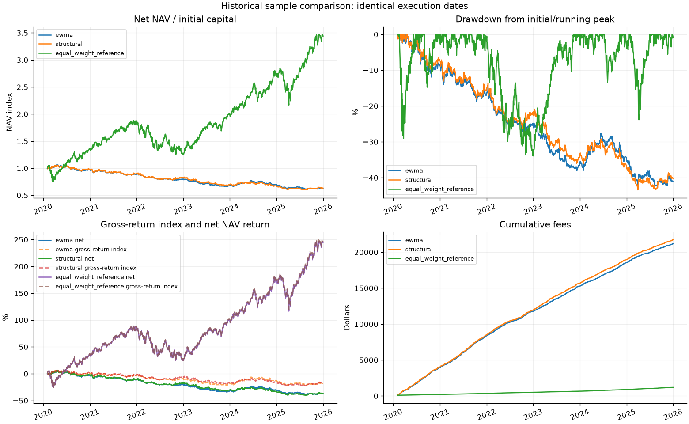

# Equity Factor Risk Model

A Python case study of cross-sectional factor estimation, structural specific-risk modeling, and equity long-short portfolio construction. The project compares a residual EWMA baseline with a regularized structural risk model using five fixed stocks and real historical prices.

The example portfolio takes a predeclared positive momentum exposure. Both long-short implementations lose money after costs in the recorded sample. The contribution is an inspectable research and accounting workflow, rather than a claim of profitable alpha.



## What is implemented

- Factor portfolios satisfying unit exposure to one characteristic and zero exposure to the others.
- Realized factor returns and residuals estimated without rewriting earlier forecasts.
- EWMA and bounded, penalized profile REML estimates of specific risk, with an optional Gaussian profile MLE fit.
- Separate covariance estimates for observed factor portfolios and latent factors, including a disclosed estimation-noise correction.
- Stock risk forecasts, constrained portfolio scaling, delayed execution, position drift, transaction fees, short-borrow costs, and dollar PnL attribution.

All research code and offline self-tests are in [`equity_lfm_project.py`](equity_lfm_project.py). The [English notebook](equity_lfm_project.ipynb) presents the same implementation in sections and has its saved outputs cleared for publication.

## Quick start

Python 3.12 and 3.13 have been tested locally. From this repository's root directory on macOS or Linux:

```bash
python3.12 -m venv .venv
source .venv/bin/activate
python -m pip install -r requirements.txt
python equity_lfm_project.py --self-test
python equity_lfm_project.py
```

Use `python3.13` in the first command if that is your installed version. On Windows, create the environment with your Python launcher and activate it with `.venv\Scripts\Activate.ps1` in PowerShell.

The first full run downloads prices from Yahoo Finance through `yfinance`; an internet connection is required. Raw vendor prices are excluded from this repository. Subsequent runs reuse the local cache when its request matches. A fresh download can differ from the snapshot used for the recorded reports because providers can revise historical adjusted prices.

To use the notebook:

```bash
python -m pip install -r requirements-notebook.txt
```

Open the notebook in VS Code or Jupyter and explicitly select this environment as its kernel. A VS Code script interpreter and a notebook kernel are separate selections.

Other runs:

```bash
python equity_lfm_project.py --fit-method mle --output-dir results_mle
python equity_lfm_project.py --refresh-data
python equity_lfm_project.py --liquidate-at-end --output-dir results_liquidated
```

Default output is written to the ignored `results/` directory. The MLE switch retains parameter bounds and penalization; it is not an unconstrained replication of a Gaussian maximum-likelihood derivation.

## Recorded results

The original snapshot contains 1,760 trading dates from 2019-01-02 through 2025-12-31 for AAPL, MSFT, AMZN, GOOGL, and JPM. Portfolio evaluation starts after the common model warmup and first delayed execution.

| Implementation | Annual return | Annual volatility | Sharpe, cash rate 0 | Maximum drawdown |
| --- | ---: | ---: | ---: | ---: |
| EWMA specific risk | -7.63% | 8.89% | -0.85 | -42.30% |
| Structural specific risk, default REML | -7.49% | 9.26% | -0.79 | -43.41% |
| Equal-weight long-only reference | 23.31% | 25.76% | 0.94 | -33.95% |

These figures include the stated transaction and borrowing costs. The reference uses the same execution dates and fee convention but has different market exposure and volatility; it is not a risk-matched comparison. Directions and hyperparameters were not selected by maximizing historical portfolio returns.

See the [full summary](reports/performance_summary.csv), [recorded configuration](reports/run_config.json), and [validation summary](reports/validation_summary.json). Additional illustrations show [factor diagnostics](reports/figures/factor_diagnostics.png) and [final marked holdings](reports/figures/latest_weights.png).

## Assumptions and practical limits

- Three characteristics are used: a common intercept, 20-day momentum, and 20-day volatility. Five stocks leave only two residual degrees of freedom per cross-section.
- Two static analyst-defined risk groups are proxies, not historical official industry classifications. They are used in specific risk, not as industry-neutrality constraints.
- The default direction is `(common, momentum, volatility) = (0, 1, 0)`. Target annual volatility is 10%, gross exposure is capped at 1, and absolute stock weights at 0.40 when rebalanced.
- Rebalancing occurs every five eligible signal dates. Transaction cost is 10 bps of full traded notional, short borrowing is 3% annualized, and cash earns 0.
- A signal formed after close `s` trades at close `s+1` and first earns returns from `s+1` to `s+2`. Caps apply after trading; holdings can drift between rebalances.
- One-step model risk scores evaluate the model's own forecast interval, not the additional delayed execution interval. Attribution is explanatory and uses realized factor estimates.
- Current survivors, vendor-adjusted histories, small cross-sections, approximate closing-price execution, and simplified borrow assumptions limit generalization.

See [methodology](docs/METHODOLOGY.md) for equations, covariance assumptions, accounting conventions, and the difference between estimation and forecasting. The [data guide](data/README.md) describes downloads and provenance.

## Validation and repository contents

Offline mathematical and accounting checks passed locally during preparation. The [included GitHub Actions workflow](.github/workflows/tests.yml) runs the offline self-tests after installing dependencies; it does not download market data. No GitHub CI run is claimed before publication. Synthetic observations are used only in tests, never as a fallback research dataset.

```text
equity_lfm_project.py         Complete implementation and self-tests
equity_lfm_project.ipynb      English notebook with cleared outputs
requirements.txt             Core dependency versions
requirements-notebook.txt    Optional notebook dependencies
docs/                        Methodology and manual publication guide
data/README.md               Data acquisition and provenance notes
reports/                     Recorded summaries and figures
.github/workflows/tests.yml  Offline test workflow
```

Follow the [manual publishing guide](docs/PUBLISHING.md) when ready. No GitHub repository has been created or uploaded as part of preparing these files. No license has been selected; the repository owner should make that choice deliberately. Private source notes and raw vendor prices are not included.
